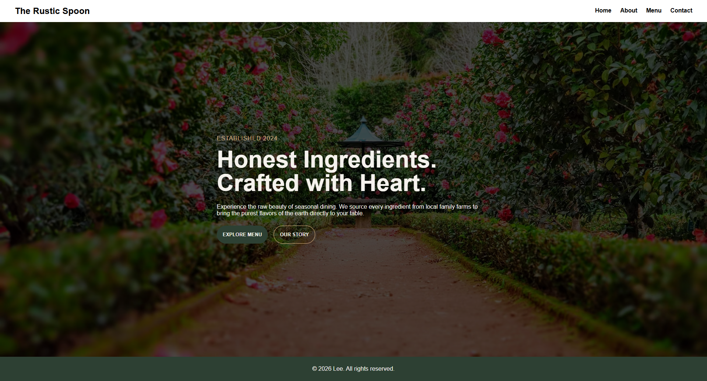

# Restaurant Page

Odin Project that allowed me to practice Webpack and DOM manipulation.


## Live Page
Visit the page here: [Restaurant Page](https://restaurant-page-ten-pink.vercel.app/)

## Features
- Multi-page restaurant website with Home, About, Menu, and Contact pages
- Tabbed navigation between pages using DOM manipulation
- Responsive design with modern CSS
- Bundled with Webpack

## Getting Started

### Clone the Repo
```bash
git clone https://github.com/LeejanAlipio/restaurant-page.git
cd restaurant-page
```

### Install Dependencies
```bash
npm install
```

### Build and Run
```bash
# Development server
npm run dev

# Production build
npm run build
```